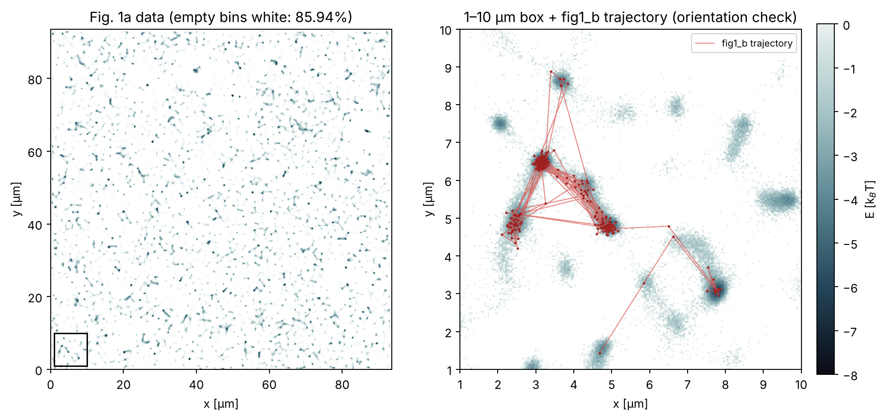
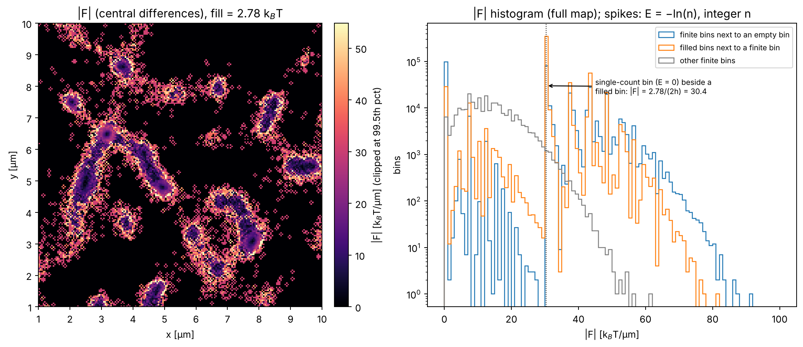
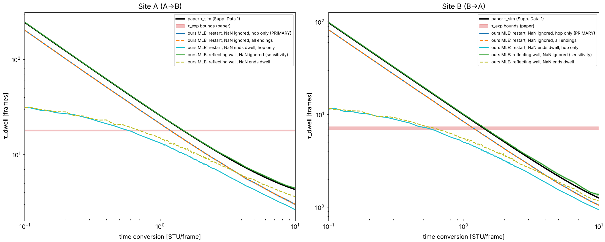
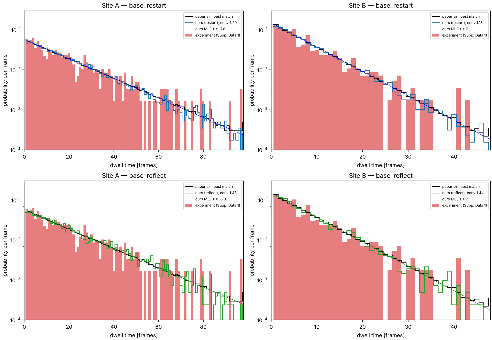
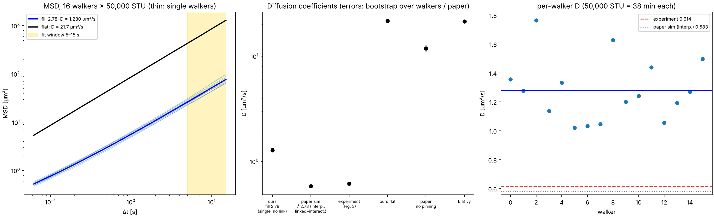
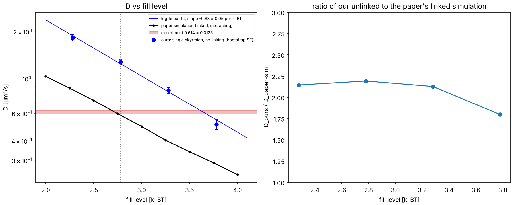

# Single-skyrmion reproduction of the pinning-landscape Thiele-model results of Fröhlich et al. (2026)

A small, honest **reproduction** (not an extension) of part of *Fröhlich, Sparmann, Brems, Rothörl, Kammerbauer, Raab, Krishnia, Kläui & Virnau, "Real-Time Modeling of Skyrmion Dynamics in Arbitrary 2D Spatially Dependent Pinning Potential Landscapes", Communications Physics 9, 243 (2026)*, https://doi.org/10.1038/s42005-026-02766-6 (CC BY 4.0). It uses only the published pinning-energy landscape (Supplementary Data 1, sheet `fig1_a`) and parameters stated in the paper. The paper's code is "available on request", so everything here is implemented from the text.

**Scope.** One thermally diffusing skyrmion, overdamped Thiele (Langevin) equation, stochastic Heun scheme: (1) force field from the binned landscape, (2) integrator validation, (3) dwell times at pinning sites A and B (the paper's Fig. 2 example) and the resulting time conversion, (4) the long-time diffusion coefficient, (5) a fill-level scan. **Not done:** skyrmion–skyrmion interactions, the density sweep, trajectory linking (Crocker–Grier), the CNN tracking, the fill-level optimisation.

Wording convention: our *single-skyrmion, unlinked model* differs from the paper's *linked, interacting simulations* by the amounts quoted below. These are comparisons between different protocols; no claim is made that the paper contains errors.

Author: Mandana Roosta, [github.com/mandanarst19](https://github.com/mandanarst19).

## Quick start
1. **Get the code and the environment** (tested with Python 3.12, numpy 2.5, scipy 1.18, numba 0.68, matplotlib 3.11, pandas 3.0, openpyxl 3.1; one CPU core is enough):
   ```
   git clone https://github.com/mandanarst19/skyrmion-pinning-thiele-reproduction.git
   cd skyrmion-pinning-thiele-reproduction
   python3 -m venv .venv && . .venv/bin/activate
   pip install -r requirements.txt
   ```
2. **Download Supplementary Data 1** (the pinning landscape; not redistributed here). Open the article page, https://doi.org/10.1038/s42005-026-02766-6 (it redirects to https://www.nature.com/articles/s42005-026-02766-6), scroll to the "Supplementary information" list at the end of the article and download **Supplementary Data 1**, the Excel file `42005_2026_2766_MOESM4_ESM.xlsx`. The article's "Data availability" statement links to the same file (anchor `#MOESM4`).
3. **Put it at exactly this path** (relative to the repository root, as set in `config.yaml`):
   ```
   mkdir -p data
   mv ~/Downloads/42005_2026_2766_MOESM4_ESM.xlsx data/42005_2026_2766_MOESM4_ESM.xlsx
   ```
4. **Run everything from the repository root:**
   ```
   sh scripts/reproduce_all.sh      # all simulations, analyses and figures; about 1.5 h on one core
   ```
   The script lists every step with its approximate run time. Simulation scripts write one file per chunk (`results/*.npz`, not tracked in git) and skip chunks that already exist, so an interrupted run can simply be restarted. You can also run single steps, e.g. `python3 scripts/step1_landscape.py` (about 1-2 min; the first call reads the xlsx and caches `data/fig1_a.npy`). The small `results/*.json` files in this repository are the numbers behind the tables below; re-running overwrites them.

`config.yaml` lists every parameter with its source (paper page, data sheet, or "ours"). Code: `src/load_landscape.py`, `forces.py`, `thiele_heun.py`, `analysis.py` (site/cluster labelling), `dwell.py`; one script per figure or result in `scripts/`.

## Parameters and sources (excerpt; full list in `config.yaml`)
| Item | Value | Source (published version) |
|---|---|---|
| Equation / integrator | Thiele, gyrotropic term neglected (G_rel = 0); Heun, dt = 1e-4 STU | p.2, p.5 |
| Units | γ = 1, k_BT = 1, µm; 1 STU = γ·1 µm²/k_BT | p.3, p.5–6 |
| Time conversion | 1 frame = (1.34 ± 0.10) STU; frame 62.5 ms; γ = (0.047 ± 0.004) k_BT s µm⁻² | p.3, p.6 |
| Bin size, forces | 45.7 nm; finite differences of the binned potential (ours: central differences, nearest-bin lookup) | p.6, p.5 |
| Fill of unsampled bins | 4 k_BT (dwell-time runs); (2.78 ± 0.03) k_BT (final) | p.7; p.4, data `fig3` |
| Site / cluster | sites: E < −2.5 k_BT with a bin < −3.5; cluster: finite connected region, +250 nm, edge clusters excluded | p.6 |
| Dwell model | P(t) = (e^{1/τ} − 1) e^{−t/τ}, t ≥ 1 frame; write-out 0.01 STU | p.3, p.6 |
| MSD | ⟨Δx²⟩ = 2dDΔt, d = 2, sliding window, linear fit 5–15 s | p.4, p.7 |
| Boundaries | periodic | p.6 |

## Figures
Landscape (fill 2.78 k_BT maps; the colour range is the paper's 0 to −8 k_BT) and the trajectory overlay used as an orientation check:


The discrete spikes in the force histogram come from E = −ln(n) with integer counts n: neighbouring bins differ by discrete amounts (e.g. a single-count bin beside a filled bin gives |F| = 2.78/(2h) = 30.4 k_BT/µm).

Dwell-time scale τ_sim(conversion) for sites A and B against the paper's curves and τ_exp bounds (all protocol variants shown with equal weight):


Dwell-time histograms (bars: experiment; black: the paper's simulated best match; coloured: ours with the MLE exponential) at each protocol's own best-match conversion, top restart (primary), bottom reflecting wall (sensitivity). The shapes are exponential in both; they differ in the conversion at which τ matches:


MSD and diffusion coefficients, and the fill-level scan:



## Results vs. paper
"Paper" values are from the text or Supplementary Data 1 (stated per row); "ours" values carry bootstrap errors over walkers.

| Quantity | Paper | Ours |
|---|---|---|
| Empty bins | ≈ 86% | 85.94% |
| Damping from the time conversion | γ = 0.047 ± 0.004 | 0.0466 (0.0434–0.0504 for 1.34 ± 0.10) |
| Energy zero level: fill 2.78 k_BT in counts | 0.031 counts/h, 134 days for 100 counts per bin | e^{−2.78}/(2 h) = 0.0310 counts/h; 100/0.0310 = 3224 h = 134.3 days |
| Free diffusion, k_BT/γ | – | 21.69 ± 0.29 µm²/s (200 walkers, flat) vs 21.44 expected |
| Force scheme reproduces exp(−E) (fill 4 k_BT, A/B cluster) | – | slope of ln(occupation) vs −E = 0.975 ± 0.003; well cores (E < −3.5): RMS 0.084 in ln P; finite/filled interface bins: median ln(P/Q) = −1.24 / +1.60; dt vs dt/2 identical (slope 1.0005) |
| **Time conversion, STU/frame** (sites A, B) | 1.34 ± 0.10 (average over many sites); Fig. 2 curves: A 1.45–1.51, B 1.35–1.47 | **1.18–1.49 depending on the handling of cluster exits (not specified in the paper)**: restart protocol (primary) A 1.19 ± 0.01, B 1.18 ± 0.01; reflecting wall (sensitivity) A 1.49 ± 0.02, B 1.44 ± 0.02 |
| τ at 1.34 STU/frame, frames (A / B) | τ_sim 19.6 / 7.44; τ_exp 17.6–18.2 / 6.81–7.41 | restart 16.07 ± 0.17 / 6.30 ± 0.05; reflecting wall 19.79 ± 0.25 / 7.62 ± 0.11 |
| D at fill 2.78 k_BT | simulation (linked, interacting) 0.583 (log-interpolated from the 2.75 and 3.0 points); experiment 0.614 ± 0.0125 µm²/s | 1.28 ± 0.05 µm²/s (single skyrmion, unlinked), ratio 2.2 |
| D without pinning | 11.9 ± 0.9 µm²/s (low density) | 21.69 ± 0.29 µm²/s |
| Suppression, flat / pinned | 20.4 (11.9 / 0.583) | 16.9 (21.69 / 1.28); ours 17% lower — **the fairest comparison** |
| d ln D / d fill | −0.744 (paper simulation, 2.25–3.75 k_BT) | −0.83 ± 0.05 (4 fills), −0.78 ± 0.06 (2.28, 2.78, 3.28) |
| Effective fill giving our D = 0.583 / 0.614 | 2.78 ± 0.03 | 3.70 ± 0.06 / 3.64 ± 0.05 (interpolated within 2.28–3.78) |

Fill scan: D = 1.83 ± 0.09, 1.28 ± 0.05, 0.84 ± 0.04, 0.51 ± 0.04 µm²/s at 2.28, 2.78, 3.28, 3.78 k_BT; ours/paper-simulation = 2.14, 2.19, 2.13, 1.80. The ratio is nearly constant (2.13–2.19) over 2.28–3.28 k_BT (1.80 ± 0.13 at 3.78 k_BT), which suggests, as a hypothesis and not a tested conclusion, a roughly fill-independent multiplicative factor (e.g. trajectory linking and/or interactions in the paper's simulations) rather than a difference in how the landscape responds to the fill.

Dwell-time detail (sites A / B). Primary configuration: restart sampling, no-site frames ignored, dwells ending in a hop, MLE. 24 walkers × 25,000 STU, 11,198 / 12,505 completed hops at 1.34 STU/frame; 21.9% / 19.4% of observed dwells end by leaving the cluster. Least squares gives 16.50 ± 0.23 / 6.37 ± 0.09 (restart) and 20.24 ± 0.30 / 7.57 ± 0.13 (reflecting wall), within a few percent of MLE. If a no-site frame ends the dwell, the matching conversion is 0.5–0.7 STU/frame for both protocols, about half the paper's 1.34, so the paper's dwell definition appears closer to "no-site frames ignored" (an inference). Mask sensitivity at 1.40 STU/frame (A / B): 4-neighbour mask 14.22 ± 0.40 / 5.70 ± 0.14; square dilation 15.48 ± 0.43 / 5.78 ± 0.16; baseline 15.38 ± 0.18 / 6.03 ± 0.05. Observation: the reflecting-wall run lies within 1–3% of the paper's τ_sim curves for conversions up to 3 STU/frame, while the restart protocol is lower by a nearly constant factor (≈ 0.82 for A, 0.84 for B); this is consistent with long dwells being truncated by cluster exits, but we do not know how the paper handled exits. Discarding exit-ending dwells biases towards shorter dwells.

## Assumptions and differences
1. **Energy zero.** E = −ln(counts over the full 2 h), one count = 0 k_BT (our inference). Supported by Σ exp(−E) = 8.12×10⁶ vs 70 skyrmions × 115,200 frames = 8.06×10⁶, and by the paper's own 0.031 counts/h / 134 days estimate for the 2.78 k_BT fill (table above).
2. **Orientation.** Rows = y, columns = x, row 0 at y = 0 (our inference). Checked with the `fig1_b` trajectory (99.5% of 380 points on finite bins vs 27% transposed, 9% flipped) and the Fig. 2 sites.
3. **Labelling.** 8-neighbour connectivity and a Euclidean 250 nm disk (not specified in the paper); sites A and B are identical in all variants, the cluster mask changes (1648 bins; 1451 with 4-neighbour; 5301 with square dilation).
4. **Forces.** Central differences on the filled potential, periodic wrap, nearest-bin lookup. A 1D step test (Δ = 4 k_BT, `scripts/step2_1d_step_test.py`) shows that this scheme turns a sharp step into a two-bin ramp: ln(P/Q) = −0.85 in the last low bin and +1.20 in the first high bin (analytic −0.82 / +1.18), the same signs and similar size as the 2D interface bins. Observation only: the paper's fill was matched with its own scheme.
5. **Dwell definitions.** A dwell is recorded only if its start is observed; A→B counts dwells ending in a hop to B; exit-ending dwells are reported separately (and as an "all endings" variant); two label rules (no-site frames ignored / ending the dwell); two fits (MLE, least squares).
6. **Cluster exits.** At fill 4 k_BT walkers leave the A/B cluster after ≈ 76 STU on average, comparable to the A→B dwell (≈ 21 STU in the restart protocol), so closed-cluster sampling is not possible. Primary: unconfined walkers restarted from the cluster's Boltzmann distribution on exit; sensitivity: reflecting wall. The paper does not specify this.
7. **MSD.** Linear fit with free intercept (the paper says "linear function"); through-origin gives 1.29 vs 1.28 µm²/s. Equal-length trajectories make the duration-weighted mean a plain mean. The flat control uses dt = 1e-2 (Heun with F = 0 is exact at any dt); a short dt = 1e-4 flat run (28.8 ± 4.0 µm²/s, 16,000 STU) was statistically insufficient and is kept as a consistency check.
8. **Statistics.** All runs are far shorter than the paper's (e.g. 8×10⁵ STU at fill 2.78 vs 8.75×10⁷ STU per fill level); the reflecting-wall run has ≈ 4,200 hops per direction (< 10⁴) and only 8 walkers, so its bootstrap errors are rough.
9. **Published vs preprint.** All values were re-checked against the published PDF; none differs from arXiv v1 apart from notation.

## Open questions (hypotheses, none tested here)
- **Why is our D 2.2× above the paper's simulation?** The paper matched its fill to *linked, interacting* trajectories; ours is a single, unlinked skyrmion. Candidates: (i) *Trajectory linking.* At 0.0080 Sk/µm² the mean spacing (≈ 11 µm) is ≈ 21 interaction decay lengths (B = 0.537 µm), suggesting weak direct interactions on average, so the paper's flat-case reduction (11.9 vs 21.4–21.7 µm²/s) may be dominated by linking (large per-frame steps, single-frame inter-cluster hops). Caveat from the paper's own U(r): pair distances are broadly distributed, and for a random arrangement ≈ 45% of skyrmions have a nearest neighbour closer than 4.9 µm, where U ≥ 1 k_BT, so interactions are not obviously negligible; the two effects were not separated. The paper's linking effect ranges from −35% to +30% across its level-matching simulations; −35% applied to our 1.28 gives 0.83, still ≈ 1.4× above 0.583 (1.36× above 0.614). (ii) *Conversion factor.* D ∝ conversion; our 1.19 (restart) or 1.49 (reflecting wall) instead of 1.34 would change D by −11% or +11%, which cannot close the gap alone. (iii) *Fill sensitivity.* With our slope the gap corresponds to a fill ≈ 0.9 k_BT higher (3.64–3.70 vs 2.78 ± 0.03). (iv) *Incomplete exploration.* Our per-walker D varies by 17% (SD), but the pooled bootstrap error is 4%, so sampling alone does not explain a factor 2. (v) *Pattern in the fill scan.* Our D / paper-simulation ratio is nearly constant (2.13–2.19 over 2.28–3.28 k_BT; 1.80 ± 0.13 at 3.78 k_BT), which suggests a fill-independent multiplicative factor (e.g. linking and/or interactions) rather than a landscape difference. This is a hypothesis only: our slope (−0.83 ± 0.05) is also steeper than the paper's (−0.744), so a small fill-dependent part cannot be excluded.
- How sensitive is D to the flat-barrier fill beyond our scan, and could inter-cluster barriers be estimated from Kramers-type escape rates instead of one flat level?
- **Isolated finite bins in the barrier region** follow from the paper's fill rule: 58% of finite bins touch an empty bin, and each isolated low-count bin is a dip of ≈ 2.8 k_BT below the flat fill. We kept them as the baseline and did not run a sensitivity test.
- How does the paper handle dwells that end in a cluster exit, and how does it define dwells across no-site frames? Our time conversion changes between 1.18 and 1.49 STU/frame with these choices.

## Attribution and license
Code: MIT, © 2026 Mandana Roosta (`LICENSE`). The landscape used here is Supplementary Data 1 of the paper (CC BY 4.0, © the authors); figures derived from it are marked as such, the file itself is not redistributed. Please cite the paper (`CITATION.cff`) and, if useful, this repository. Changes made: only binning/fill/force processing and simulations described above.

## Summary (plain English)
I rebuilt a minimal version of Fröhlich et al.'s skyrmion model from their published pinning map and stated parameters, using a single non-interacting skyrmion simulated with an overdamped Thiele (Langevin) equation and a stochastic Heun integrator. Its dwell times at two pinning sites give a simulation-to-camera time conversion of 1.18–1.49 STU/frame depending on how cluster exits are handled (the paper's value is 1.34 ± 0.10), and its long-time diffusion coefficient (1.28 ± 0.05 µm²/s) is about 2.2× the paper's linked, interacting simulation, while the ratio of free to pinned diffusion (16.9 vs 20.4) agrees within 17%. I list the possible causes (trajectory linking, interactions, fill level, conversion factor, limited sampling) as open, untested questions rather than conclusions.
